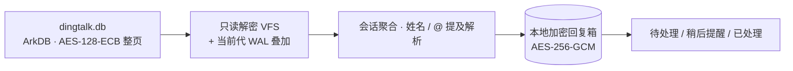

<p align="center">
  
</p>

<h1 align="center">DingLater Mac</h1>

<p align="center">
  本地、只读、实时的钉钉「稍后回复」收件箱<br/>
  <sub>直接读取正在使用的加密 <code>dingtalk.db</code>，把新消息收进本地加密的回复箱。</sub>
</p>

<p align="center">
  <a href="https://github.com/shiwenbin1617/DingLaterMac/releases/latest">
    
  </a>
  
  
  <a href="LICENSE"></a>
</p>

> **只供学习与个人使用。** 本项目是非官方独立实现，与钉钉 / 阿里巴巴无关。请只读取你自己有权访问的数据，并遵守所在地法律与钉钉服务条款。

## 下载

不想自己编译，可以直接使用预编译包（Apple 芯片）：

1. 打开 [Releases](https://github.com/shiwenbin1617/DingLaterMac/releases/latest)，下载 `DingLater-Mac-v0.1.0-arm64.zip`。
2. 解压后把 `DingLater.app` 拖进「应用程序」。
3. 首次打开如果被 Gatekeeper 拦截（本包未做 Apple 公证），右键点 `DingLater.app` →「打开」，或执行：

   ```sh
   xattr -dr com.apple.quarantine /Applications/DingLater.app
   ```

4. 打开「数据源与设置」，填入钉钉数据库密钥。

预编译包只支持 macOS 13+，当前为 Apple 芯片（arm64）；Intel Mac 请从源码构建。仓库不提供、也不内置任何密钥。

## 功能

- **实时读取**：内置只读解密 VFS，直接打开钉钉正在写入的 `dingtalk.db`（ArkDB，整页 AES-128-ECB），并叠加当前代 WAL 中已提交的帧；不用退出钉钉，也不用先生成快照。
- **自动发现**：优先连接 `~/Library/Application Support/DingTalkMac/*/DBFiles/dingtalk.db`；也可以连接标准 SQLite 数据库或一次性解密快照。
- **会话聚合**：按人/群聚合，一对一会话解析对方姓名，群显示群名；正文里的 `@<uid>` 会用消息自带的 `atIds` 映射替换成显示名。
- **本地稍后处理**：待处理 / 稍后提醒 / 已处理；支持按会话批量完成、搜索、菜单栏计数。
- **本地加密**：每条消息用 AES-256-GCM 单独加密，主密钥存放在 macOS 钥匙串；系统通知不显示正文。
- **原生界面**：SwiftUI + AppKit，菜单栏常驻，支持浅色 / 深色 / 跟随系统，窗口可置顶。

## 从源码构建

要求 macOS 13 或更新版本；构建需要带 macOS 26 SDK 的 Xcode 26（或相应的命令行工具），测试需要含 Swift Testing 的 Swift 6 工具链。

```sh
git clone https://github.com/shiwenbin1617/DingLaterMac.git
cd DingLaterMac
./scripts/build.sh
open dist/DingLater.app
```

首次使用需要提供钉钉数据库密钥（16 个字符或 32 位十六进制）。三种方式任选其一：

1. 打开「数据源与设置」→「钉钉实时数据源」→ 填入并保存；
2. 写入 `~/Library/Application Support/DingLaterMac/dingtalk.key`（权限 0600）；
3. 设置环境变量 `DINGLATER_DINGTALK_KEY=...`。

密钥是安装/账号级的，更换账号或重装钉钉后需要重新获取。应用只读数据源，不发送消息、不标记已读。

首次连接会为 128 张消息分表记录当前最大主键作为基线，回复箱从连接之后的新消息开始收录；刚连接时列表为空是预期行为。之后每 5 秒检查一次。

## 工作原理

钉钉 Mac 的 `dingtalk.db` 是 ArkDB：每个 4096 字节页用 AES-128-ECB（无 IV、无填充）整体加密，因此相同的明文页（例如页 1 的 `SQLite format 3\0`）在不同库里会得到相同密文。应用通过一个 C 只读 VFS（`Sources/DingTalkVFS`）在读取时解密页面：



- 只读打开，标记 `SQLITE_IOCAP_IMMUTABLE`，不锁库；
- 解析 `-wal`，只取与 WAL 头 salt 匹配的当前代，并应用到最后一个 commit 帧；
- 把页 1 的 WAL 标志改回非 WAL，让系统 SQLite 以普通只读库打开；
- 读到的消息再写入本地加密回复箱。

本地回复箱位于 `~/Library/Application Support/DingLaterMac/`，主密钥在钥匙串中。

## 目录结构

```
Sources/
  DingLaterCore/   数据源读取、姓名与 @ 提及解析、本地加密回复箱
  DingTalkVFS/     C 只读解密 VFS（ArkDB + WAL 叠加）
  DingLaterMac/    SwiftUI 界面、菜单栏、设置
Tests/             Swift Testing
scripts/           构建、测试、图标生成
docs/              README 图片
```

## 隐私与开源

- 仓库、测试和发布物**不包含**任何真实密钥、账号、群名或消息；测试使用纯合成数据。
- `.gitignore` 已忽略 `dingtalk.key`、`*.key`、`*.pem`、`*.db`、`dist/`、`.build/` 等。
- 请勿把本机的 `~/Library/Application Support/DingTalkMac/`、解密快照或 `dingtalk.key` 提交或上传。
- 读取的源文件保持原有存储与权限，应用不会修改它。

## 已知限制

- 仅支持 macOS，界面为中文；预编译包为 Apple 芯片。
- 实时性取决于钉钉是否把新消息提交到 WAL，应用每 5 秒轮询一次。
- 连接后只收录新消息（基线语义）；删除或清理分表导致主键倒退时会暂停并提示。
- 目前按记录收录，尚未做「只看 @ 我」等过滤；附件以可读取的文字或类型占位展示。
- 预编译包使用本机临时签名，**未做 Apple 公证**，首次打开需要右键「打开」或移除 quarantine 属性。

## 开发与测试

```sh
./scripts/test.sh

# 可选：验证一份自己提供的可读快照
DINGLATER_SAMPLE_DB=/path/to/readable.db ./scripts/test.sh

# 可选：验证实时加密库
DINGLATER_LIVE_DB=/path/to/dingtalk.db DINGLATER_DINGTALK_KEY=... ./scripts/test.sh
```

构建脚本默认使用本机临时签名；正式分发可设置 `DINGLATER_SIGN_IDENTITY` 选择自己的签名身份，并另行完成 Apple 公证。

## 许可证

[MIT](LICENSE) © 2026 DingLater Mac contributors

灵感来自 [DingLater](https://github.com/zJay26/DingLater)；本项目为独立实现。
